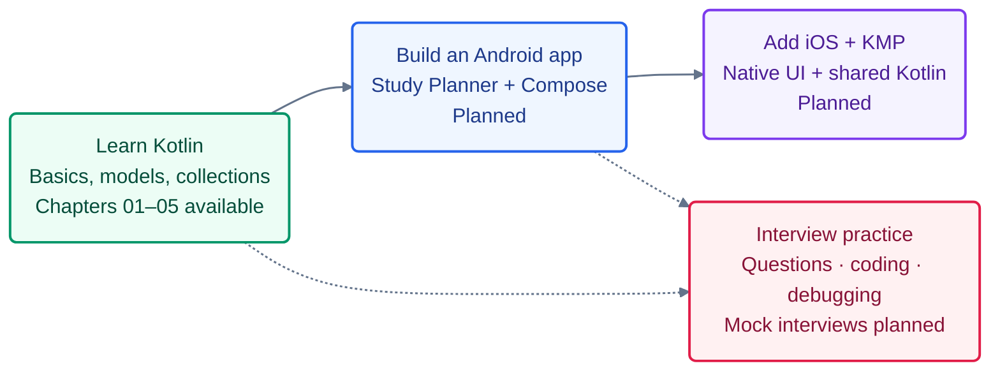

# Kotlin 101 — The Mobile Workshop

Learn Kotlin through clear lessons and small coding workshops. Start with the language, then build an Android app and extend it with iOS and Kotlin Multiplatform.

**[Start learning with Chapter 01](chapters/01-values-and-types/LESSON.md)**

## Your learning path

Build toward a **Study Planner app** for organizing topics, planning study sessions, and tracking progress. Small Kotlin labs teach the rules first; later chapters bring those ideas into one growing mobile app.

**Learn it → build it → explain it.** Current lessons include code predictions, debugging tasks, and interview questions. Dedicated coding interview sets and mock interviews arrive in the planned later chapters.

Explore the chapter stages and what you will build

| Stage | What you will build | Availability |
| --- | --- | --- |
| Kotlin foundations · 01–08 | Session models, validation, progress reports, and tested Kotlin rules | **01–05 available**; 06–08 planned |
| Coroutines and Flow · 09–12 | Cancellable search and predictable, tested state updates | Planned |
| Android · 13–15 | The Study Planner app with Compose screens, ViewModel, and repositories | Planned |
| Native iOS · 16–18 | A SwiftUI client with native state and concurrency | Planned |
| Kotlin Multiplatform · 19–22 | Shared Kotlin business rules used by Android and iOS | Planned |
| Data and platform features · 23–30 | Networking, saved data, offline behavior, and a native versus shared UI comparison | Planned |
| Quality and interview practice · 31–40 | Failure tests, profiling, an independent feature, and mock interviews | Planned |

The [full roadmap](docs/CURRICULUM.md) lists each chapter's topics and practical outcome.

## How to follow a chapter

1. **Learn:** read the lesson and follow its small examples. You can begin in your browser without installing anything.
2. **Practice:** follow the workshop and change the starter code. Hints are there if you get stuck.
3. **Review:** compare your work with the explained solution and try the follow-up challenge.

Read the lessons here on GitHub; their pages live in **`chapters/`**. The runnable exercise code lives in **`kotlin-labs/`**.

When you are ready to code locally, follow the [one-time setup guide](kotlin-labs/README.md). In Android Studio, open **`kotlin-labs`** and keep the lesson open alongside it.

Workshop commands create a local working copy for your answers. Normal Git commits keep those answers out of the shared starter code.

## Available chapters

| Chapter | What you will learn | What you will build |
| --- | --- | --- |
| [01 Values and types](chapters/01-values-and-types/README.md) | Values, variables, types, arithmetic, and text | A study-time display that keeps the remaining minutes |
| [02 Control flow and functions](chapters/02-control-flow-and-functions/README.md) | Functions, conditions, ranges, validation, and loops | A planner with valid sessions and numbered rounds |
| [03 Null safety and errors](chapters/03-null-safety-and-errors/README.md) | Nullable types, safe calls, parsing, and error contracts | A form that handles missing and invalid session input |
| [04 Classes and modeling](chapters/04-classes-and-modeling/README.md) | Classes, properties, value equality, copies, enums, and sealed results | Session models that preserve the original when completing a copy |
| [05 Collections and complexity](chapters/05-collections-and-complexity/README.md) | Lists, sets, maps, snapshots, grouping, sorting, and Big O | A progress report with unique sessions, completed totals, and ID lookup |

More chapters are coming one at a time. The Android, iOS, and KMP apps are planned.

Returning for interviews? Follow the [focused Android and Kotlin refresh](docs/CURRICULUM.md#focused-android-and-kotlin-refresh): a six-week core at 10–12 hours per week, with two buffer weeks. The [optional starting-point diagnostic](chapters/00-starting-point/README.md) can help identify what to revisit.

To improve a lesson or contribute code, see [Contributing](CONTRIBUTING.md).
