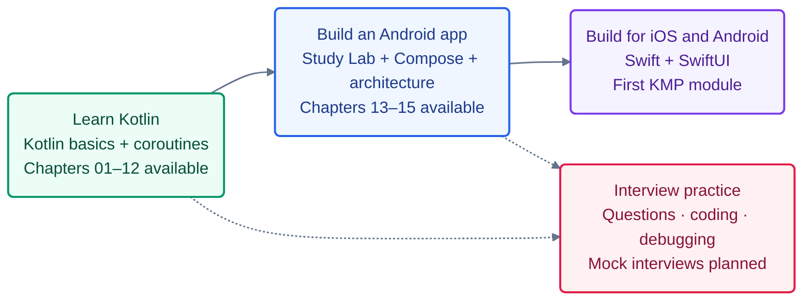

# Kotlin 101 — The Mobile Workshop

Learn Kotlin through clear lessons and small coding workshops. Start with the language, then build an Android app and extend it with iOS and Kotlin Multiplatform.

**[Start learning with Chapter 01](chapters/01-values-and-types/LESSON.md)**

## Your learning path

Build toward a **Study Planner app** for organizing topics, planning study sessions, and tracking progress. Small Kotlin labs teach the rules first; later chapters bring those ideas into one growing mobile app.

**Learn it → build it → explain it.** Current lessons include code predictions, debugging tasks, and interview questions. Dedicated coding interview sets and mock interviews arrive in the planned later chapters.

Explore the chapter stages and what you will build

| Stage | What you will build | Availability |
| --- | --- | --- |
| Kotlin foundations · 01–08 | Session models, validation, progress reports, and tested Kotlin rules | **01–08 available** |
| Coroutines and Flow · 09–12 | Cancellable search and predictable, tested state updates | **09–12 available** |
| Android · 13–15 | The Study Lab app, followed by Compose screens, ViewModel, and repositories | **13–15 available** |
| Native iOS · 16–18 | Swift models, then a SwiftUI client with native state and concurrency | **16–18 available** |
| Kotlin Multiplatform · 19–22 | A shared module, then business rules and app integration | **19–20 available**, 21–22 planned |
| Data and platform features · 23–30 | Networking, saved data, offline behavior, and a native versus shared UI comparison | Planned |
| Quality and interview practice · 31–40 | Failure tests, profiling, an independent feature, and mock interviews | Planned |

The [full roadmap](docs/CURRICULUM.md) lists each chapter's topics and practical outcome.

## How to follow a chapter

1. **Learn:** read the lesson and follow its small examples. You can begin in your browser without installing anything.
2. **Practice:** follow the workshop and change the starter code. Hints are there if you get stuck.
3. **Review:** compare your work with the explained solution and try the follow-up challenge.

Read the lessons here on GitHub; their pages live in **`chapters/`**. The independent Kotlin exercise code lives in **`kotlin-labs/`**. The Android app starts in **`mobile/`**, with its own [setup guide](mobile/README.md). Chapter 16 uses the separate [Swift lab setup](swift-labs/README.md) before the native [SwiftUI client](mobile/iosApp/README.md).

When you are ready to code locally, follow the [one-time setup guide](kotlin-labs/README.md). In Android Studio, open **`kotlin-labs`** and keep the lesson open alongside it.

Workshop commands create a local working copy for your answers. Normal Git commits keep those answers out of the shared starter code.

## Available chapters

| Chapter | What you will learn | What you will build |
| --- | --- | --- |
| [01 Values and types](chapters/01-values-and-types/README.md) | Values, variables, types, arithmetic, and text | A study-time display that keeps the remaining minutes |
| [02 Control flow and functions](chapters/02-control-flow-and-functions/README.md) | Functions, conditions, ranges, validation, and loops | A planner with valid sessions and numbered rounds |
| [03 Null safety and errors](chapters/03-null-safety-and-errors/README.md) | Nullable types, safe calls, parsing, and error contracts | A form that handles missing and invalid session input |
| [04 Classes and modeling](chapters/04-classes-and-modeling/README.md) | Classes, properties, value equality, copies, enums, and sealed results | Session models that preserve the original when completing a copy |
| [05 Collections and complexity](chapters/05-collections-and-complexity/README.md) | Lists, sets, maps, snapshots, grouping, sorting, and Big O | A progress report with unique sessions, completed totals, and ID lookup |
| [06 Functions as values](chapters/06-functions-as-values/README.md) | Lambdas, higher-order functions, extensions, receivers, scope functions, and sequences | Composable session filters and eager versus lazy previews with callback counts |
| [07 Abstraction and dependencies](chapters/07-abstraction-and-dependencies/README.md) | Interfaces, composition, inheritance, generics, variance, delegation, and constructor injection | Replaceable in-memory storage shared by a planner and progress report |
| [08 Tests and Kotlin pitfalls](chapters/08-tests-and-kotlin-pitfalls/README.md) | Unit tests, edge cases, equality versus identity, shallow copies, and read-only collections | Regression tests that protect editable plans and saved history |
| [09 Suspension and execution](chapters/09-suspension-and-execution/README.md) | Suspension versus blocking, scopes, dispatchers, `launch`, and `async` | Sequential and concurrent dashboard loaders with controlled fake requests |
| [10 Structured concurrency](chapters/10-structured-concurrency/README.md) | Job ownership, cancellation, cleanup, timeouts, failures, supervision, and shared state | A search session that cancels obsolete work and protects active-request changes |
| [11 Flow and observable state](chapters/11-flow-and-observable-state/README.md) | Cold streams, buffering, latest operators, combining, StateFlow, and SharedFlow | Debounced topic search combined with progress in shared screen state |
| [12 Testing asynchronous behavior](chapters/12-testing-asynchronous-behavior/README.md) | Test scopes, virtual time, injected dispatchers, boundaries, and controlled interleavings | Learner-written regressions for retry deadlines and rapid search replacement |
| [13 Android runtime and lifecycle](chapters/13-android-runtime-and-lifecycle/README.md) | Application components, Context, intents, resources, recreation, and process restoration | A Study Lab Android draft that restores its topic and completed count |
| [14 Jetpack Compose](chapters/14-jetpack-compose/README.md) | Composition, hoisted/saveable state, keyed effects, lists, layouts, and accessibility | A controlled study list/editor with independent drafts and timed save feedback |
| [15 Android app architecture](chapters/15-android-app-architecture/README.md) | UI/data layers, repositories, ViewModel, lifecycle-aware collection, navigation, and saved state | A catalogue with loading, empty/error/retry states and per-session planning notes |
| [16 Swift for Kotlin developers](chapters/16-swift-for-kotlin-developers/README.md) | Swift syntax, optionals, value/reference semantics, enums, protocols, generics, and ARC | Independent study-plan values and a callback that safely outlives its owner |
| [17 SwiftUI and app lifecycle](chapters/17-swiftui-and-app-lifecycle/README.md) | Observation, managed state, bindings, view identity, navigation, scenes, and accessibility | A native study list/detail editor with explicit draft and scene lifetimes |
| [18 Swift concurrency and tests](chapters/18-swift-concurrency-and-tests/README.md) | Tasks, cancellation, actor isolation, Sendable, and async tests | A review prompt that handles retries and rejects late results |
| [19 Project and build model](chapters/19-project-and-build-model/README.md) | Gradle wrapper, Kotlin DSL, version catalog, targets, and source sets | Build a shared study label for Android and an iOS simulator |
| [20 Shared boundaries](chapters/20-shared-boundaries/README.md) | Common interfaces, constructor injection, and `expect`/`actual` functions | A shared session planner that validates a draft before requesting a platform-generated ID |

More chapters are coming one at a time.

Returning for interviews? Follow the [focused Android and Kotlin refresh](docs/CURRICULUM.md#focused-android-and-kotlin-refresh): a six-week core at 10–12 hours per week, with two buffer weeks. The [optional starting-point diagnostic](chapters/00-starting-point/README.md) can help identify what to revisit.

To improve a lesson or contribute code, see [Contributing](CONTRIBUTING.md).
