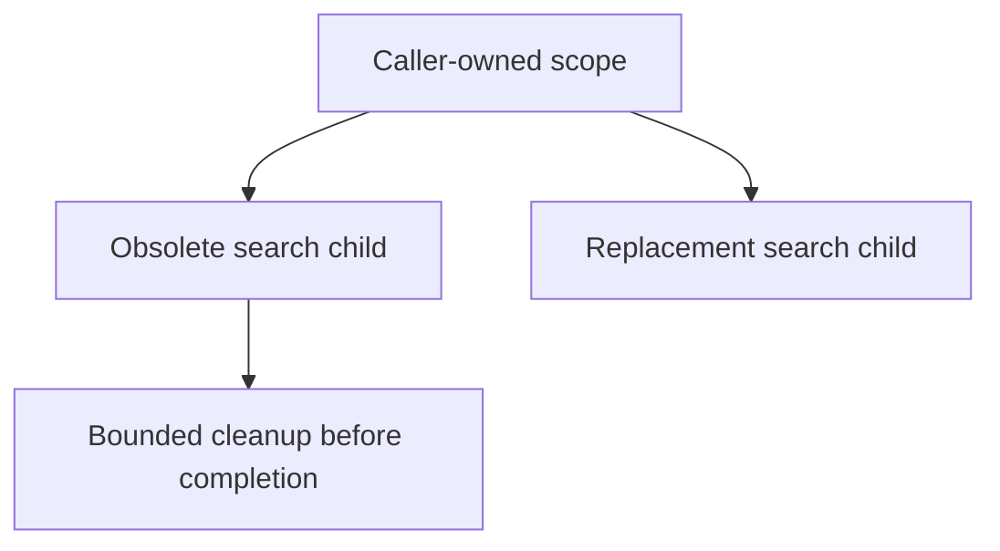

# Lesson 10 Structured concurrency

The user types “Ko,” then “Kotlin.” The second result appears first. A late old result then replaces it. Starting coroutines was not enough: the feature needs a rule for ownership, replacement, cancellation, and publication.

Read after [Chapter 09](../09-suspension-and-execution/LESSON.md). Split this lesson into jobs and cancellation, then failure policies and shared state. Every Kotlin block is a complete console program. The explicit `runBlocking<Unit>` keeps the entry point's result `Unit`, including when its last `try` expression could return a value. Follow the [workshop setup](WORKSHOP.md#sync-run-and-open-your-copy). To run a block locally, keep your generated `SearchLifecycle.kt` safe outside its source folder, temporarily replace its contents with the block prefixed by `package workshop.ch10`, and invoke `:ch10-structured-concurrency:run`. Restore the working file before running its acceptance tests, which expect the original declarations.

## Follow the job tree

A scope carries a context including a `Job`. Children created with its `launch` or `async` normally belong to that job. Cancelling an owner cancels its descendants. Cancelling one child normally leaves the owner and other children active. An ordinary child failure has different propagation rules, which we will test below.



```kotlin
import kotlinx.coroutines.CompletableDeferred
import kotlinx.coroutines.awaitCancellation
import kotlinx.coroutines.cancelAndJoin
import kotlinx.coroutines.isActive
import kotlinx.coroutines.launch
import kotlinx.coroutines.runBlocking

fun main() = runBlocking<Unit> {
    val started = CompletableDeferred<Unit>()
    val child = launch {
        try {
            started.complete(Unit)
            awaitCancellation()
        } finally {
            println("Child cleaned")
        }
    }
    started.await()
    child.cancelAndJoin()
    println("Child cancelled: ${child.isCancelled}")
    println("Owner active: $isActive")
}
```

Output:

```text
Child cleaned
Child cancelled: true
Owner active: true
```

`cancel()` requests cancellation; it does not wait for completion. `join()` waits, without requesting cancellation or returning a result. `cancelAndJoin()` does both. It can itself throw if its caller is cancelled. `awaitCancellation()` suspends until cancellation and never returns normally. The one-shot signal ensures the child is running before we cancel it. See [`cancelAndJoin`](https://kotlinlang.org/api/kotlinx.coroutines/kotlinx-coroutines-core/kotlinx.coroutines/cancel-and-join.html) and [exception propagation](https://kotlinlang.org/docs/exception-handling.html).

## Make computation cooperate

```kotlin
import kotlinx.coroutines.CancellationException
import kotlinx.coroutines.cancel
import kotlinx.coroutines.currentCoroutineContext
import kotlinx.coroutines.ensureActive
import kotlinx.coroutines.launch
import kotlinx.coroutines.runBlocking

suspend fun sumThrough(limit: Int): Long {
    var total = 0L
    for (value in 1..limit) {
        currentCoroutineContext().ensureActive()
        total += value
    }
    return total
}

fun main() = runBlocking<Unit> {
    val child = launch {
        currentCoroutineContext().cancel()
        try {
            println(sumThrough(5))
        } catch (cancelled: CancellationException) {
            println("Computation stopped")
            throw cancelled
        }
    }
    child.join()
    println("Cancelled: ${child.isCancelled}")
}
```

Output:

```text
Computation stopped
Cancelled: true
```

Cancellation is cooperative. Suspending operations such as `delay` and a waiting `await` check it. CPU code needs checkpoints such as `ensureActive`, or periodic `yield` when it should also give other work a turn. `ensureActive` throws when the current job is cancelled; it does not choose a thread or make a blocking call interruptible. A timeout likewise cannot forcibly stop arbitrary blocking or noncooperative work. See [`ensureActive`](https://kotlinlang.org/api/kotlinx.coroutines/kotlinx-coroutines-core/kotlinx.coroutines/ensure-active.html).

## Preserve cancellation when translating expected failures

```kotlin
import kotlinx.coroutines.CancellationException
import kotlinx.coroutines.runBlocking

suspend fun readTopic(mode: String): String {
    if (mode == "cancel") throw CancellationException("obsolete")
    throw IllegalStateException("offline")
}

suspend fun displayTopic(mode: String): String {
    return try {
        readTopic(mode)
    } catch (cancelled: CancellationException) {
        throw cancelled
    } catch (failure: IllegalStateException) {
        "Unavailable: ${failure.message}"
    }
}

fun main() = runBlocking<Unit> {
    println(displayTopic("failure"))
    try {
        displayTopic("cancel")
    } catch (cancelled: CancellationException) {
        println("Cancellation propagated")
    }
}
```

Output:

```text
Unavailable: offline
Cancellation propagated
```

This example's source agreement treats `IllegalStateException` as recoverable. Cancellation is also a subtype of that exception, so catch and rethrow it first. A broad `Exception` catch or an unexamined `runCatching` result can turn cancellation into apparent failure content. Recover only failures the API agreement identifies; unexpected errors should remain visible. See [`CancellationException`](https://kotlinlang.org/api/kotlinx.coroutines/kotlinx-coroutines-core/kotlinx.coroutines/-cancellation-exception/).

The catch around this direct function call observes its thrown exception. Launching a child inside a `try` and immediately leaving the `try` is not equivalent: failure can arrive later through its owning scope. Exception object identity across coroutine boundaries is not an application contract; check the type and relevant information.

## Bound this operation without hiding another cancellation

```kotlin
import kotlinx.coroutines.TimeoutCancellationException
import kotlinx.coroutines.awaitCancellation
import kotlinx.coroutines.runBlocking
import kotlinx.coroutines.withTimeout
import kotlinx.coroutines.withTimeoutOrNull

fun main() = runBlocking<Unit> {
    val result: String? = withTimeoutOrNull(10L) {
        try {
            awaitCancellation()
        } finally {
            println("Timed work cleaned")
        }
    }
    println("Local timeout: ${result == null}")
    try {
        withTimeoutOrNull(60_000L) {
            withTimeout(0L) { "Never started" }
        }
    } catch (expired: TimeoutCancellationException) {
        println("Inner timeout propagated")
    }
}
```

Output:

```text
Timed work cleaned
Local timeout: true
Inner timeout propagated
```

`withTimeout` throws on its deadline. `withTimeoutOrNull` converts its own timeout to null, while another cancellation still propagates. A nonpositive library timeout skips the block; the workshop deliberately rejects negative inputs and uses zero as an immediate timeout. These are cancellation deadlines, not exact completion-time guarantees. See [`withTimeoutOrNull`](https://kotlinlang.org/api/kotlinx.coroutines/kotlinx-coroutines-core/kotlinx.coroutines/with-timeout-or-null.html).

The workshop's block always returns a non-null `SearchOutcome`, so null unambiguously identifies that wrapper's timeout. If a block could legitimately return null, the same test would be ambiguous. Do not catch every `TimeoutCancellationException` and assume it belongs to the wrapper: the inner example demonstrates the distinction.

## Decide which children must succeed together

```kotlin
import kotlinx.coroutines.CompletableDeferred
import kotlinx.coroutines.async
import kotlinx.coroutines.awaitCancellation
import kotlinx.coroutines.coroutineScope
import kotlinx.coroutines.isActive
import kotlinx.coroutines.launch
import kotlinx.coroutines.runBlocking

fun main() = runBlocking<Unit> {
    try {
        coroutineScope {
            val started = CompletableDeferred<Unit>()
            launch {
                try {
                    started.complete(Unit)
                    awaitCancellation()
                } finally {
                    println("Sibling cleaned")
                }
            }
            val failing = async<Int> {
                started.await()
                error("required request failed")
            }
            failing.await()
        }
    } catch (failure: IllegalStateException) {
        println("Failed: ${failure.message}")
    }
    println("Owner active: $isActive")
}
```

Output:

```text
Sibling cleaned
Failed: required request failed
Owner active: true
```

A regular `coroutineScope` treats child failure as failure of the operation, cancels siblings, and waits for them before rethrowing. Catch outside that local operation when the caller can recover. `async` retaining an exception for `await` does not remove this child-to-parent relationship. Catching an `await` inside an already failed regular scope does not restore that scope. See the [coroutine scope contract](https://kotlinlang.org/api/kotlinx.coroutines/kotlinx-coroutines-core/kotlinx.coroutines/coroutine-scope.html).

## Supervise genuinely independent children

```kotlin
import kotlinx.coroutines.CompletableDeferred
import kotlinx.coroutines.async
import kotlinx.coroutines.runBlocking
import kotlinx.coroutines.supervisorScope

fun main() = runBlocking<Unit> {
    supervisorScope {
        val releasePeer = CompletableDeferred<Unit>()
        val peer = async {
            releasePeer.await()
            "Peer completed"
        }
        val optional = async<String> { error("optional unavailable") }
        try {
            optional.await()
        } catch (failure: IllegalStateException) {
            println("Optional unavailable")
        }
        releasePeer.complete(Unit)
        println(peer.await())
    }
}
```

Output:

```text
Optional unavailable
Peer completed
```

`supervisorScope` isolates a child's failure from its peers while preserving ownership and waiting. Handle the failed child explicitly, as the `await` catch does here. If that exception escaped the supervisor's own block, the block would fail and cancel its remaining children. Supervision is a policy for independent work, not automatic error recovery. See [`supervisorScope`](https://kotlinlang.org/api/kotlinx.coroutines/kotlinx-coroutines-core/kotlinx.coroutines/supervisor-scope.html).

A longer-lived owner can use a parented `SupervisorJob`, but someone must still end that owner's lifetime. Do not pass a fresh `Job` to a builder to detach a request. A `CoroutineExceptionHandler` observes uncaught failures; it does not restart a failed coroutine or replace expected recovery. The search lab keeps the supplied owner's policy, translating only its agreed source failures.

## Protect shared state across suspending transitions

```kotlin
import kotlinx.coroutines.Dispatchers
import kotlinx.coroutines.coroutineScope
import kotlinx.coroutines.launch
import kotlinx.coroutines.runBlocking
import kotlinx.coroutines.sync.Mutex
import kotlinx.coroutines.sync.withLock

fun main() = runBlocking<Unit> {
    val mutex = Mutex()
    var count = 0
    coroutineScope {
        repeat(50) {
            launch(Dispatchers.Default) {
                repeat(20) {
                    mutex.withLock { count += 1 }
                }
            }
        }
    }
    println("Count: $count")
}
```

Output:

```text
Count: 1000
```

`count += 1` reads and writes; it is not one indivisible operation. A `Mutex` protects a critical section, suspending contenders rather than blocking their threads. `withLock` releases it when the block exits, including by exception. A `val` reference to mutable state, or a volatile field alone, does not make a compound transition atomic. See [shared mutable state](https://kotlinlang.org/docs/shared-mutable-state-and-concurrency.html) and [`Mutex`](https://kotlinlang.org/api/kotlinx.coroutines/kotlinx-coroutines-core/kotlinx.coroutines.sync/-mutex/).

Confining state to one thread is another tool, but calls can still interleave when one suspends. The search session protects the entire “cancel and join old job, launch and remember replacement” transition. Joining waits for old publication too. A cancellation check is a cooperation checkpoint, not an atomic barrier against cancellation racing a non-suspending callback that already began. Its mutex protects that job reference, not arbitrary source or publisher state. The supplied owner context and those dependencies still need compatible state-access rules. A mutex is non-reentrant; do not recursively call the same protected operation while holding it.

## Wait for narrowly bounded cleanup

```kotlin
import kotlinx.coroutines.CompletableDeferred
import kotlinx.coroutines.NonCancellable
import kotlinx.coroutines.awaitCancellation
import kotlinx.coroutines.cancelAndJoin
import kotlinx.coroutines.delay
import kotlinx.coroutines.launch
import kotlinx.coroutines.runBlocking
import kotlinx.coroutines.withContext

fun main() = runBlocking<Unit> {
    val started = CompletableDeferred<Unit>()
    val child = launch {
        try {
            started.complete(Unit)
            awaitCancellation()
        } finally {
            withContext(NonCancellable) {
                delay(1L)
                println("Cleanup finished")
            }
        }
    }
    started.await()
    child.cancelAndJoin()
    println("Join returned")
}
```

Output:

```text
Cleanup finished
Join returned
```

`finally` runs as cancellation unwinds. If necessary cleanup itself must suspend, a small `withContext(NonCancellable)` region can finish that cleanup. Keep it bounded; enclosing the entire search would prevent prompt replacement. Do not use `NonCancellable` as a `launch` or `async` context to escape the parent relationship. See [`NonCancellable`](https://kotlinlang.org/api/kotlinx.coroutines/kotlinx-coroutines-core/kotlinx.coroutines/-non-cancellable/).

## Check your understanding

1. How do requesting cancellation and waiting for completion differ?
2. Which failure should become visible error content, and which should stop the operation?
3. Why must a local timeout wrapper preserve cancellation from its owner or another nested operation?
4. When would a regular scope be preferable to supervision?
5. Why can a single-threaded caller still interleave two operations around `cancelAndJoin`?
6. Why should replacement wait for obsolete cleanup before starting its new source?
7. What prevents a cancelled request from publishing a result, and what still depends on a cooperative source?

**[Continue to the workshop](WORKSHOP.md)** · [Chapter entry](README.md)
