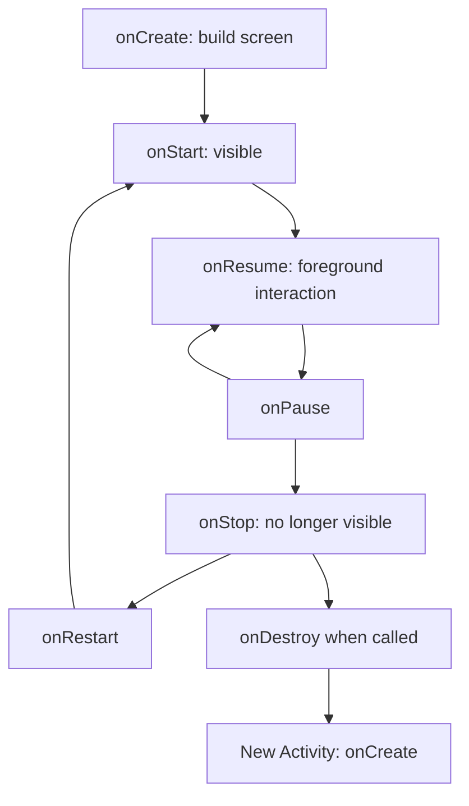

# Lesson 13 Android runtime and lifecycle

Use the immutable [ch13-v1 source](https://github.com/roshanevala/Kotlin-101-The-Mobile-Workshop/tree/ch13-v1) or [its ZIP](https://github.com/roshanevala/Kotlin-101-The-Mobile-Workshop/archive/refs/tags/ch13-v1.zip) in a new folder for this chapter's View-based app. The current `mobile` launcher continues with Chapter 14; keep existing answers safe in their original workspace.

You type a study topic and complete two sessions. The screen changes size, Android creates another Activity, and the topic/count return to their defaults. Your Kotlin fields belonged to one object; Android needs enough saved information to rebuild the screen.

Start after [Chapter 12](../12-testing-asynchronous-behavior/LESSON.md). This lesson introduces Android's execution model before Compose. Use the provided small XML/View screen to observe the runtime. Chapter 14 teaches declarative UI; Chapter 15 introduces ViewModel and broader application architecture.

Follow the [mobile setup](../../mobile/README.md), then open the generated `MainActivity.kt` named in the [workshop](WORKSHOP.md). Code snippets here explain API calls and excerpts; run the provided app to observe them.

## Android chooses component entry points

Earlier programs began at `fun main()`. Android installs an APK containing compiled code, resources, and a manifest. The operating system starts a process when needed, loads app code through the Android runtime, and calls registered component entry points. You do not instantiate your launcher Activity in `main`.

| Component | Role | In this chapter |
| --- | --- | --- |
| Activity | Hosts a user-facing screen/window and receives lifecycle callbacks | `MainActivity` hosts the session draft |
| Service | Provides an entry point for ongoing work under platform restrictions | Recognize it; no service is added |
| Broadcast receiver | Receives matching broadcasts/events | Recognize it; no receiver is added |
| Content provider | Exposes structured data through a defined interface | Recognize it; no provider is added |

A service is not automatically a worker thread. Activity callbacks and click listeners ordinarily execute on the main thread; blocking them can stop drawing and input. Do not put `Thread.sleep`, long loops, or `runBlocking` in these callbacks. Android process lifetime is controlled by the system, so a global coroutine scope or singleton is not a persistence mechanism. [Application fundamentals](https://developer.android.com/guide/components/fundamentals).

An APK is installable. An Android App Bundle (`.aab`) is a publishing format from which distribution tools generate APKs. We build debug APKs for this local workshop; store publication is later work.

## Find the manifest, code, and resources

In the new `mobile/androidApp` module:

| Path | What it owns |
| --- | --- |
| `src/main/AndroidManifest.xml` | Application/theme metadata and launcher Activity declaration |
| `src/main/res/layout/activity_main.xml` | The small View hierarchy |
| `src/main/res/values/strings.xml` | User-facing text, defaults, and plural resources |
| `src/main/res/values/styles.xml` | The screen theme |
| `src/main/kotlin/.../WorkshopWindow.kt` | Fixed system-bar/keyboard inset handling and lifecycle logging |
| `src/practice/kotlin/.../MainActivity.kt` | Your generated Activity answer |
| `src/androidTest/kotlin/.../SessionLifecycleTest.kt` | Device acceptance checks |

Resources become generated `R` identifiers. `R.layout.activity_main` identifies a layout; `R.id.topic_input` identifies a View; `R.string.default_topic` identifies text. `setContentView` creates the layout's View objects, then `findViewById` retrieves a typed widget. `EditText.text.toString()` reads its current text, and `Button.setOnClickListener` registers a callback.

A resource identifier is an integer handle, not the text itself. `getString(R.string.default_topic)` resolves the current string; `topic.setText(R.string.default_topic)` uses EditText's resource-ID overload. This is different from displaying a literal number: use a string/plural resource for the completed count, as `renderCompleted` does.

Keep wording in resources so it can later vary by language and configuration. Android can select alternative resources after a configuration change. The current screen provides one layout and a light theme; a full theme/localization system is outside this mission. [App resources](https://developer.android.com/guide/topics/resources/providing-resources).

The app targets API 36, where system bars and cutouts need inset handling. The provided window helper adds safe padding, including space for the keyboard, while the ScrollView lets short windows scroll. Keep that scaffolding in place while repairing state. Its minimum SDK 30 matches the native inset API used. [Edge-to-edge Views](https://developer.android.com/develop/ui/views/layout/edge-to-edge).

## Context supplies access, not ownership of everything

`Activity` is a kind of `Context`. In its methods, `this`, `resources`, and `getString` connect to Android services and configuration-aware resources. An Activity context also carries screen/window/theming information. `applicationContext` belongs to the application process and has a different lifetime.

Passing a Context where required is normal. Keeping an old Activity or its Views in a static/companion object can retain an obsolete screen and its resources. A long-lived object should not hold a screen reference simply to keep the draft alive. An application context does not make UI windows or task state immortal. [Context API](https://developer.android.com/reference/android/content/Context).

## Intents and permissions describe boundaries

The manifest declares `MainActivity` as exported with `MAIN` and `LAUNCHER` intent entries so the launcher can open it. An `Intent` describes a requested action. An explicit intent names a particular component; an implicit intent describes an action/data for the system to resolve.

The workshop's terminal launch names this specific Activity:

```sh
adb shell am start -n workshop.studylab.practice/workshop.studylab.MainActivity
```

Run it only with the practice app installed and `adb` on your PATH. The first part is the installed application ID; the second is the Activity class. Opening the **Study Lab practice** launcher icon is equivalent for the first run. You do not need to build a second screen or accept arbitrary intent extras for the draft mission. [Intents](https://developer.android.com/guide/components/intents-filters).

Permissions regulate access to protected capabilities. Some are install-time/normal permissions; dangerous permissions can require a runtime request. Declare and request only capabilities the feature needs, with a plan for denial. This in-memory draft needs no camera, location, notification, storage, or network permission. Do not add permissions to solve a state-loss bug. [Permissions overview](https://developer.android.com/guide/topics/permissions/overview).

The Activity's `lateinit var` View properties are non-null references assigned later in `onCreate`, after layout creation. Read them only after that assignment; earlier access throws an initialization error. This lets Android's callback establish the references without inventing a View before a screen exists.

Its `companion object` holds class-shared declarations. The `private const val` keys are immutable compile-time strings, so every replacement Activity uses the same Bundle names. Sharing constant names is different from storing mutable topic/count data globally; the draft still belongs to the current Activity and its saved state.

## Follow one Activity's lifecycle

`MainActivity : Activity()` declares the superclass. `override` methods implement callbacks Android invokes. Call the corresponding `super` method so the framework can perform its own work. `onCreate(savedInstanceState: Bundle?)` receives nullable saved state; build the View tree before trying to read or update its widgets.



This is a simplified lifecycle map, not a guarantee that every callback always occurs. A paused Activity can remain visible, for example in a multi-window arrangement. `onStop` concerns visibility; `onDestroy` concerns that Activity instance when the callback is delivered. A process can be terminated without `onDestroy`, so it is not a reliable final-save hook. [Activity lifecycle](https://developer.android.com/guide/components/activities/activity-lifecycle).

In Logcat filter by **StudyLifecycle**. The provided logger records process ID, Activity object identity, and callback name. It does not record topic text. Try launch → Home → return → Recreate screen. Identify whether the existing object resumed or a new one was created. Individual callback order can vary with the transition and platform; use the observed trace rather than memorizing a single universal transcript.

The sample logs the six main callbacks and saving. Android can also invoke `onRestart` when returning to a stopped instance; the sample does not override/log that callback. A lack of a custom log line is not proof that a framework callback did not happen.

## A configuration change can replace the object

Rotation, window size, locale, font settings, and other configuration changes can require recreation. Normally Android destroys the old Activity and creates another with the appropriate resources. Fields on the old object are not copied automatically into the new object's fields.

The workshop's **Recreate screen** button invokes `recreate()` to make this replacement easy to reproduce even if emulator auto-rotation is disabled. It does not kill the process. Do not fix the mission by locking orientation, declaring that your Activity handles all configuration changes, or keeping a static instance. Recreation is a normal platform behavior to support. [Configuration changes](https://developer.android.com/guide/topics/resources/runtime-changes).

## Save enough information to rebuild

A `Bundle` stores supported key/value types, including small strings and integers. The following API sketch uses an unrelated bookmark:

```kotlin
outState.putInt("bookmark.page", page)
val restoredPage = savedInstanceState?.getInt("bookmark.page", 1) ?: 1
```

The stable key connects a saved value to its later read. The integer default handles an absent key; the outer Elvis default handles an absent Bundle. Use matching types. For strings, a null/absent value can choose a default while an explicitly empty string remains valid. `""` is not the same as missing saved state.

`onSaveInstanceState(outState)` receives a Bundle to populate. Read the current widget text there, including edits made without clicking another button. Save the backing completed count. On creation, restore both before rendering; otherwise the UI may show a restored number while later clicks still start from zero.

The input is limited to 80 characters, so the draft remains small. Do not save Views, Context, large lists, images, or a running job. Saved state records lightweight reconstruction information; durable session history belongs in persistent storage introduced later. [Bundle API](https://developer.android.com/reference/android/os/Bundle).

Android normally saves parts of a View hierarchy automatically when widgets have IDs; EditText text is a common example. For this explicit Bundle exercise, the supplied topic and count widgets have **`android:saveEnabled="false"`** in both variants. This prevents automatic widget restoration from concealing a broken implementation. A later screen can choose automatic state or Compose's state APIs instead; manual saving of every widget is not a universal app rule.

Keep `super.onSaveInstanceState(outState)` for other framework state. Save-callback timing is not a fixed point between `onPause` and `onStop`; targets on newer Android versions save after stopping. The mission relies on the saved-state contract, not a hardcoded log ordering.

## Distinguish three kinds of survival

| Situation | What happens to this draft? | Appropriate evidence |
| --- | --- | --- |
| Activity recreation in the same process | A new Activity can restore its saved small values | Recreate button or ActivityScenario test; compare object identity |
| Eligible system process restoration with retained task/state | The old process is gone; Android can provide saved state to a new process/Activity | Background, kill background process, reopen retained task; confirm process ID changes |
| Finishing/dismissing a task or deliberately force-stopping | Saved task state is not durable history; a fresh plan is expected here | Finish/close and launch fresh; distinguish from ordinary Home/return |

Home alone does not prove destruction. “Don't keep activities” demonstrates Activity destruction, not process death. Swiping a task away or `am force-stop` is not the same experiment as killing an eligible background process while its task remains. Saved state is not a database or a guarantee of recovery after every dismissal. [Saving UI state](https://developer.android.com/topic/libraries/architecture/saving-states).

A ViewModel can later retain in-memory state across configuration changes, but its memory still disappears with the process. Saved-state mechanisms and persistent storage address different lifetimes. Learn those broader choices in Chapter 15 and the data chapters after mastering this small boundary.

## Tests observe the screen's contract

The supplied Android tests run **on a device/emulator** with AndroidJUnitRunner and ActivityScenario. They edit Views on the UI thread and ask the platform to recreate the Activity. JUnit 4 is the Android runner's test format here; the existing Kotlin labs keep their independent JUnit 5 setup.

An important regression types a topic and recreates immediately, with no intervening count click. Another increments twice, recreates, increments once, and recreates again. Together they catch stale text fields and a display restored without its backing count. A fresh-launch test helps catch “restoration” implemented as global state. [AndroidJUnitRunner](https://developer.android.com/training/testing/instrumented-tests/androidx-test-libraries/runner).

A device test calling `recreate` establishes Activity replacement, not genuine process death. Complete the separate process-restoration observation in the workshop, and state which evidence you actually collected. Reference passes do not establish that your own attempt is complete.

**[Repair the disappearing draft](WORKSHOP.md)** · [Back to the chapter](README.md)
