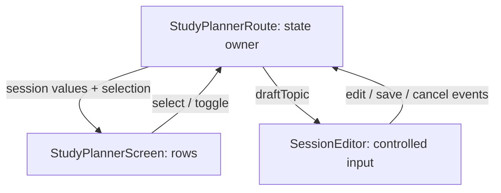

# Lesson 14 Jetpack Compose

A user edits the topic to “Coroutines,” but Save still commits “Kotlin.” The screen and its owner have separate copies of text. Compose makes this boundary explicit: describe the UI from state, and send user events back to the owner that can change that state.

Start after [Chapter 13](../13-android-runtime-and-lifecycle/LESSON.md). Keep Kotlin lambdas, data classes, immutable values, cancellation, and saved-state lifetimes in mind. This chapter introduces Compose UI; ViewModel, repositories, navigation, and lifecycle-aware Flow collection belong to Chapter 15.

Follow [mobile setup](../../mobile/README.md), then open the generated Chapter 14 `StudyPlannerActivity.kt` named in the [workshop](WORKSHOP.md). The app already contains the fixed layout/theme scaffolding and a deliberately broken state owner/editor.

## Describe the screen, then let state change it

Chapter 13 obtained Views and changed their properties. A `@Composable` function describes UI for supplied values. `Text(topic)` declares what text belongs here now; changing observed state can cause Compose to execute relevant functions again. That reevaluation is **recomposition**.

`ComponentActivity.setContent` starts a composition. The supplied Activity hosts `StudyLabTheme { StudyPlannerRoute() }`. `StudyPlannerRoute` owns state, `StudyPlannerScreen` renders the list/layout, and `SessionEditor` should render supplied text and emit callbacks.

Composition is not an Activity lifecycle callback. Recomposition does not mean Activity recreation, and a composable function is not guaranteed to execute once, in a fixed order, or on every frame. Avoid updating a model, launching work, or invoking a save callback while describing UI. Put changes in event handlers or an appropriate effect. [Compose mental model](https://developer.android.com/develop/ui/compose/mental-model).

## Make changes observable and retain the value

The following small example uses imports already present in the generated Activity. It is a complete composable function, not a console entry point. To try it in a temporary workspace copy, add it below the existing declarations and temporarily host `CounterExample()` inside `setContent`/`StudyLabTheme`. Give that temporary host safe padding with `Box(Modifier.safeDrawingPadding()) { CounterExample() }`, adding imports for `Box` and `safeDrawingPadding` from `androidx.compose.foundation.layout`; this keeps the button clear of the edge-to-edge system bars. Restore the normal route afterward.

```kotlin
@Composable
fun CounterExample() {
    var count by remember { mutableIntStateOf(0) }
    Button(onClick = { count++ }) {
        Text("Count: $count")
    }
}
```

Initially the button says `Count: 0`; clicking changes it to `Count: 1`.

- `mutableIntStateOf` makes an observable integer state holder. `mutableStateOf` also supports values such as strings and booleans.
- `remember` retains the holder across recompositions at this position in the composition. It does not survive Activity recreation.
- `by` delegates reads/writes to the state holder, using the supplied `getValue`/`setValue` imports. `count++` changes observable state; it is not an ordinary local variable that Compose cannot observe.

For comparison, replace the declaration in a temporary copy with `var count = 0`. Changing that plain local value does not itself schedule recomposition. Even if another reason later causes recomposition, the function creates that local zero again. Do not rely on unrelated rendering to reveal a change.

For a second comparison, use `var count by rememberSaveable { mutableIntStateOf(0) }`. It retains this supported small value through the saved-state mechanism when recreation provides saved state. This is not permanent storage, nor a guarantee after task dismissal. Remember Chapter 13's distinction between a new Activity, an eligible restored task/process, and a fresh plan. [State in Compose](https://developer.android.com/develop/ui/compose/state).

A remembered mutable list is not automatically observable when its elements change. Prefer immutable values and replacing state, or learn the appropriate observable collection API before using it. This bounded workshop stores six small authoritative values, then derives two immutable `StudySession` rows on each composition. It does not introduce a custom list saver or a persistence layer.

## Hoist state to the shared owner

Hoisting means moving state to a caller that coordinates the components using it. A controlled child takes a value and callbacks; it does not remember another authoritative copy of the same value.



The editor API already states the boundary:

```kotlin
@Composable
fun SessionEditor(
    draftTopic: String,
    onDraftChange: (String) -> Unit,
    onSave: () -> Unit,
    onCancel: () -> Unit
)
```

This is a signature excerpt; the provided function supplies the body. `OutlinedTextField` takes `value` and `onValueChange`. Its displayed value should come from `draftTopic`, and its edit callback should forward to `onDraftChange`. Buttons receive the save/cancel lambdas as events.

Remembering `draftTopic` again inside the child creates a second copy that may ignore a new parent's value. The owner may then save text the user is no longer seeing. Hoisting is about agreement over ownership, not a rule that no composable may have local state. A child can own local UI details that no other component needs.

In this mission, the owner distinguishes **committed topic** from **unsaved draft**. Typing changes only the draft. Save commits a trimmed, nonblank value to the selected row. Cancel restores that row's committed value. Selecting another row discards the prior unsaved draft, while selecting the same row preserves it. Define those policies before coding; Compose does not choose them for you.

## Recomposition should preserve identity

A `LazyColumn` composes list content as it is needed. `items(sessions, key = { "session-${it.id}" })` gives each row a stable identity. This app edits topics, so topic text is not an identity: two rows can eventually have equal topics, and renaming should not turn a row into another row.

The fixed screen derives progress using `sessions.count { it.completed }`. That is a value calculated from current state, not another counter to synchronize with every checkbox. Clicking a completion control changes only the identified row. The nested checkbox has its own event; it should not accidentally select another row or toggle twice. [Lists and keys](https://developer.android.com/develop/ui/compose/lists).

The two initial rows have stable IDs 1 and 2. Six saved primitives hold their topics, completion flags, selected ID, and draft. The immutable row list is rebuilt from those values. This deliberately small catalogue lets the lesson focus on state and events. Dynamic insertion/deletion, repositories, and larger saved models are later architecture work.

## Arrange UI with composables and modifiers

Read the fixed `StudyPlannerScreen` alongside the running app:

| API | Purpose here |
| --- | --- |
| `Column` / `Row` | Arrange children vertically/horizontally |
| `LazyColumn` / `items` | A scrollable page with keyed session rows |
| `Modifier` | Apply layout, input, and semantic behavior in a deliberate order |
| `Card`, `Text`, `Checkbox`, `OutlinedTextField`, buttons | Material UI building blocks |
| `Scaffold` | Coordinate screen content and safe inset padding |
| `MaterialTheme` | Supply the workshop's colors and typography |
| `@Preview` | Render a supplied fixture in a supported IDE preview |

Modifier order can change measurement, drawing, and input areas. For example, padding inside a clickable region differs from spacing outside it. `dp` is used for layout dimensions, while typography uses scalable text sizing. Read the existing chain instead of copying arbitrary padding values to repair state.

The Compose screen uses Scaffold's safe-drawing insets and consumes that padding once. It does not attach Chapter 13's View padding helper to the same tree. The whole page can scroll when an editor/keyboard or a small window leaves less space. Check portrait, landscape, and keyboard visibility; state tests alone do not establish layout quality. [Compose insets](https://developer.android.com/develop/ui/compose/system/insets-ui).

The preview passes fixture rows and callbacks with empty bodies; it demonstrates rendering, not working persistence or event ownership. Run the real Activity and tests for behavior. The course does not claim that IDE previews were exercised unless that is recorded separately.

## Run effects when their keys change

A save-notice timer is UI work tied to the composition. The saved topic is authoritative data; the brief “Topic saved” notice is transient feedback. The route keeps that feedback separate from the six saved values.

The provided effect has this shape:

```kotlin
LaunchedEffect(savedRevision) {
    if (savedRevision > 0) {
        delay(2_000L)
        showSaved = false
    }
}
```

Each successful Save increments the transient revision and shows the notice. A changed key cancels the prior effect and starts another, giving the latest save its own interval. Typing/reselecting state is not a reason to repeat a save. `LaunchedEffect(Unit)` runs on entry at that call site and is not restarted by a later revision. A boolean key can also miss another Save while the notice is already visible.

Keep `savedRevision` and `showSaved` in ordinary remembered state: restoring an Activity should restore the draft without replaying obsolete feedback. The effect must not initialize or overwrite the draft on selection. An effect keyed to selected ID runs again when that call site enters after recreation, so copying committed topic into draft there can destroy restored unsaved text. Selection's explicit event handler sets its new draft instead. [Effects and keys](https://developer.android.com/develop/ui/compose/side-effects).

Other APIs serve different lifetimes: `rememberCoroutineScope` gives event handlers a composition-owned scope; `DisposableEffect` pairs setup with cleanup; `rememberUpdatedState` can give a long-lived effect an updated callback/value without restarting it. Recognize their roles, but the required mission uses only the keyed notice effect. External work and model mutations still need an appropriate owner rather than a call in the rendering body.

## Make the UI understandable through semantics

Visible text, field labels, selected state, checkbox state, roles, and touch areas matter to accessibility as well as tests. Material controls supply standard behavior; the screen adds headings and labels identifying session actions. A checkbox should communicate what it changes, not just an unlabeled square.

The saved notice uses a polite live region so accessibility services can announce the brief update without interrupting the current announcement. The fixed session rows are selectable and expose stable session identity. Their content can change or become equal without losing that identity. UI test tags help tests locate controls, but tags are not screen-reader labels or a substitute for accessible visible text. [Compose semantics](https://developer.android.com/develop/ui/compose/accessibility/semantics).

The tests inspect the semantic tree. Some containers merge descendants, so tests deliberately use the unmerged tree for row-topic text. This does not require application users to see implementation tags. Automated checks do not replace a TalkBack/font-size/device review.

## Verify values, events, and time at the right boundary

Tests of `SessionEditor` supply values and record callbacks without a real repository. They catch a child that caches the original text or ignores edit events. Activity tests then exercise Save/Cancel, identity, completion, recreation, and notices together. The old Chapter 13 Activity tests remain in the workspace too.

The notice tests control the **Compose test clock**, including rendering frames. This differs from directly driving `TestScope` in Chapter 12: timing checks need frame execution as well as the effect's delay. They inspect the notice before its lifetime ends, after it ends, and after a second save has restarted it. No guessed wall-clock sleep is the test's synchronization strategy. [Compose testing](https://developer.android.com/develop/ui/compose/testing).

A green owner test alone does not prove a child is controlled. A green isolated child test alone does not prove the owner updates the selected model correctly. Check both contracts, and state whether you tested saved-state reconstruction, actual Activity recreation, or a real process restart. This chapter's automated recreation test does not independently establish process-death behavior.

**[Repair the shared editor state](WORKSHOP.md)** · [Back to the chapter](README.md)
