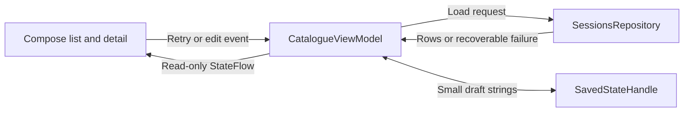

# Lesson 15 Android app architecture

A loading spinner, a retry button, and a draft note look like UI details. Their lifetimes are different: a request belongs to its state owner, the displayed screen belongs to a navigation entry, and an unfinished note needs a small saved representation. Architecture names these boundaries so that a rotation or a late response does not change the rules accidentally.

Read [Chapter 14](../14-jetpack-compose/LESSON.md) first. This chapter uses the interfaces and constructor injection from Chapter 07, cancellation and Flow from Chapters 10–11, and virtual-time tests from Chapter 12. Follow [mobile setup](../../mobile/README.md) to build the supplied app before the [mission](WORKSHOP.md).

## Follow one event through two layers

The **UI layer** turns state into a screen and sends user events to its state owner. The **data layer** provides application data behind a repository interface. An optional domain layer can hold reusable or complex rules; this tiny feature does not need another layer or Gradle module.



This is **unidirectional data flow**: state reaches the UI, while events return to an owner. A composable does not fetch a fresh catalogue whenever it recomposes. The repository does not keep a reference to an Activity, render a message, or navigate.

The shared [repository file](../../mobile/androidApp/src/main/kotlin/workshop/studylab/data/SessionsRepository.kt) declares `suspend fun loadSessions(): List<StudySession>`. The ViewModel receives that interface through its constructor. Production wiring supplies `DemoSessionsRepository`; a test supplies a controlled fake. No dependency-injection container is necessary to replace a constructor argument. [Architecture recommendations](https://developer.android.com/topic/architecture/recommendations).

Our demo suspends for 400 ms, fails its first attempt with `IOException`, then returns Kotlin and Android. It makes no network or database calls. The delay illustrates loading; tests control time rather than waiting 400 real milliseconds. Since the fixture already suspends without blocking, wrapping it in an IO dispatcher would add no useful work. A future blocking data source must make its own operations safe for callers.

## Make every screen state explicit

Open [CatalogueState](../../mobile/androidApp/src/main/kotlin/workshop/studylab/CatalogueState.kt). A sealed interface represents four mutually exclusive results:

| State | Screen behavior | Exit |
| --- | --- | --- |
| Loading | Progress and a loading label | A result or failure |
| Content | Session buttons and Reload | Open an ID or reload |
| Empty | No-sessions message | Reload |
| Error | Recoverable, generic message | Try again |

An empty list is a valid response, not a transport failure. `Content(emptyList())` also fails to express the specified empty screen. Several booleans such as `loading`, `failed`, and `hasRows` could accidentally describe contradictory screens; one state type makes their relationship explicit.

Keep a private `MutableStateFlow<CatalogueState>` and expose a read-only `StateFlow` using `asStateFlow()`. Screens can observe it; they cannot assign a new result. Copy the returned list with `toList()` before publishing it so later mutation of the repository's list does not silently change an already published value. The session records themselves are immutable values. This is a snapshot boundary, not a claim that every Kotlin `List` is deeply immutable.

On a fresh load or retry, publish Loading, then Content/Empty/Error. This lab replaces visible content during refresh instead of showing old content under a spinner. That is an explicit product policy, not a universal architecture rule. Notes remain separate and survive all these transitions. [UI state production](https://developer.android.com/topic/architecture/ui-layer/state-production).

## Let an Android owner retain the ViewModel

A `ViewModel` holds screen state and handles events. A `ViewModelStoreOwner` retains it. In this app, [CatalogueActivity](../../mobile/androidApp/src/main/kotlin/workshop/studylab/CatalogueActivity.kt) calls `viewModel(factory = factory)` outside the `NavHost`, so both destinations share one **Activity-owned** catalogue model.

The factory creates the repository and uses `createSavedStateHandle()` from the owner's creation extras. It supplies constructor arguments when the owner needs a new instance. Recomposition and Activity recreation reuse the instance already in that owner's store; do not call the constructor directly in the rendering body. The small factory is fixed scaffolding, but trace it before editing the mission. [ViewModel factories](https://developer.android.com/topic/libraries/architecture/viewmodel/viewmodel-factories).

`viewModelScope.launch` starts owned work. Clearing the owner cancels that scope. A ViewModel retained through rotation does not need another initial request; a ViewModel created after process termination does. Keep Activity, View, and screen callbacks out of the model so it cannot retain a destroyed UI.

Activity ownership is deliberately broad enough for this two-screen feature. In a larger app, screen or navigation-graph ownership can release feature state sooner. The choice of owner, rather than the name ViewModel, determines the lifetime. [ViewModel overview](https://developer.android.com/topic/libraries/architecture/viewmodel).

## Separate request cancellation from a failed load

Retry is an event. Keep the current load's `Job` and cancel obsolete work before launching the replacement. Expected `IOException` failures become Error. `CancellationException` must propagate; leaving a screen or replacing work is not an error to show to the learner.

Cancellation is cooperative. A badly behaved source can finish after its caller was cancelled. Check `currentCoroutineContext().ensureActive()` before publishing its result and before publishing a caught IO failure. The check throws on a cancelled job, preventing that old request from changing the current state. This is useful even though the supplied demo's `delay` already cooperates.

Do not catch every `Exception` and turn it into a friendly error. That can swallow cancellation and conceal programming failures. The repository contract identifies the recoverable IO case for this lab. Use the existing coroutine test scheduler and controlled completion signals to check ordering, rather than hoping one request is slower. [Cancellation](https://kotlinlang.org/docs/cancellation-and-timeouts.html).

`IOException` is imported from `java.io`; `CancellationException`, `currentCoroutineContext`, and `ensureActive` come from `kotlinx.coroutines`. The screen invokes model events on Main; the already suspending fixture does not block that thread.

## Collect while the UI can use the value

The fixed [CatalogueApp](../../mobile/androidApp/src/main/kotlin/workshop/studylab/CatalogueScreen.kt) uses this expression inside its composable body:

```kotlin
val state by model.state.collectAsStateWithLifecycle()
```

`collectAsStateWithLifecycle` comes from `androidx.lifecycle.compose`; the delegated value uses `androidx.compose.runtime.getValue`. It collects from the relevant lifecycle at STARTED or above by default, pauses collection below that threshold, and observes the current StateFlow value on return. That is different from unconditionally collecting in a long-lived coroutine.

Pausing this UI subscription does **not** cancel the ViewModel or a request launched in `viewModelScope`. This mission loads on explicit events and retains the latest result even while its UI collector is paused. Chapter 11's sharing policy and the lifetime of a subscriber remain separate decisions. [Lifecycle-aware state collection](https://developer.android.com/develop/ui/compose/state).

## Navigate with identity, then look up data

`rememberNavController()` owns the navigation controller in the composition. `NavHost` maps routes to destinations and maintains a back stack. Our fixed Navigation Compose 2 graph has two string routes: `catalogue` and `session/{sessionId}`. It declares `sessionId` as `NavType.IntType`, navigates with `session/2`, and passes only that integer to the detail screen.

The destination finds the current record by ID. It does not pass a whole mutable session object or use editable topic text as identity. Equal topic names therefore still open different sessions. A missing ID gets a recovery message and Back instead of displaying another row by position. This small graph uses the string-route API of the pinned library; it does not require a serialization plugin. Other navigation APIs can be compared after this ownership model is clear. [Navigation](https://developer.android.com/guide/navigation), [Navigation Compose API](https://developer.android.com/reference/kotlin/androidx/navigation/compose/package-summary).

The visible Back action calls `popBackStack()`. System Back also returns from detail to the catalogue. The shared ViewModel remains because its Activity owner remains. A note keyed by session ID can be read again after popping and reopening detail. A destination-owned ViewModel would have a different lifetime; do not assume Back always retains every ViewModel.

## Save enough to reconstruct, not the whole screen

The planning note is an **unfinished draft**, not a saved catalogue update. `SavedStateHandle.getStateFlow("note-$id", "")` gives an observable saved string; assigning through the same handle key updates that stream. The owner accepts empty/whitespace text unchanged, rejects replacements longer than 120 Kotlin string units, and accepts edits only for an ID in the current Content.

| Mechanism | Recomposition | Activity recreation | New process with eligible saved state |
| --- | --- | --- | --- |
| Ordinary ViewModel field | Same owner retains it | Retained owner keeps it | Lost |
| SavedStateHandle draft | Same owner retains it | Same owner keeps it | Can reconstruct a new owner |
| Navigation saved state | Keeps the back stack | Restores the destination | Can restore the destination |
| Repository load result here | Held by the ViewModel | Retained with it | Reloaded from the source |

The handle contains only small per-ID strings. It does not contain the catalogue, a repository, a Job, or an Activity. Saved state has lifecycle/task limits and is not durable storage; do not promise restoration after force-stop or deliberate task dismissal. After eligible process restoration, the new demo repository fails its first load again. Retrying can reveal the restored detail destination and note. [SavedStateHandle](https://developer.android.com/topic/libraries/architecture/viewmodel/viewmodel-savedstate).

## Check each boundary with the appropriate tool

Local JUnit 4 tests replace `Dispatchers.Main` with a `StandardTestDispatcher` before creating a ViewModel, share its scheduler with `runTest`, and reset Main afterward. The tests use a real `ViewModelStore` and clear it for cleanup. This reuses Chapter 12's virtual-time ideas in the Android workspace; Android's local tests use JUnit 4 here rather than the Kotlin labs' JUnit 5 setup. [Coroutine testing on Android](https://developer.android.com/kotlin/coroutines/test).

The local tests check transitions, snapshots, cancellation, saved-handle values, IDs, and boundaries. A new handle initialized with restored values checks reconstruction logic without claiming to reproduce the operating system's save cycle. Device tests cover semantic UI, real navigation, lifecycle-paused collection, and Activity recreation. A process-restoration experiment is separate evidence. Run the commands in the workshop and read their distinct reports.

Explain before coding: why could a note pass a rotation test while still failing process restoration? Which lifetime would change if `viewModel()` moved inside each destination?

**[Start the workshop](WORKSHOP.md)**
