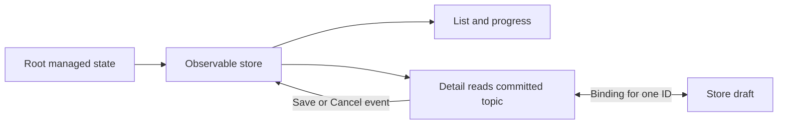

# Lesson 17 SwiftUI and app lifecycle

Changing text is easy to see; deciding who owns it takes more care. A SwiftUI view is a value describing the screen. Recreating that value, navigating away from it, or backgrounding its scene should change data only according to an explicit contract.

Read [Chapter 16](../16-swift-for-kotlin-developers/LESSON.md) first. This chapter introduces the native iOS client of Study Lab. Follow [iOS setup](../../mobile/iosApp/README.md) to build the starter before the [mission](WORKSHOP.md). The Android project and Swift language lab remain independent.

## Follow the app, scene, and view

The fixed [StudyLabApp](../../mobile/iosApp/Sources/StudyLabApp.swift) has `@main` and conforms to `App`. Its `body: some Scene` declares a `WindowGroup`, which creates a view hierarchy for a window. The window hosts StudyShell, which displays a tip toggle and constructs StudyRoot.

`View` describes UI through `body: some View`. The `some` spelling lets the compiler retain a concrete view type without making you write its full nested generic type. SwiftUI's view builders assemble content such as Text, Toggle, List, Form, and conditional sections into that hierarchy.

A body can be evaluated again when inputs/dependencies change. A view initializer or a body evaluation is not an Activity lifecycle callback or proof of a new process. Keep loading, saving, and mutation out of rendering; invoke actions from user events. Our store initializer only creates two cheap, deterministic records. [Managing model data](https://developer.apple.com/documentation/swiftui/managing-model-data-in-your-app).

## Give changing data an observable owner

Open [StudyStore](../../mobile/iosApp/Sources/StudyStore.swift). `@Observable` generates observation support for its class properties. Reading observed properties during view evaluation forms dependencies; changes let SwiftUI update the relevant UI. A computed count can read the observed sessions array, so the progress text follows completion changes.

Observation and ownership answer different questions. A plain class property may be observable while still being created again when its containing view value is reconstructed. `@State` lets SwiftUI manage storage for an owner at a stable view identity. It also works for a small Boolean, as shown by this excerpt from the fixed StudyShell:

```swift
@State private var showTip = false
```

The shell passes `showTip` into StudyRoot. Changing it reconstructs that child value, while its correctly managed store should remain attached to the same root identity. State's default initializer can still be evaluated during view construction; expensive work or side effects do not belong there. With Xcode 27, the SDK implements the State attribute through a macro; earlier SDK documentation also describes the property-wrapper API. The relevant contract is managed storage and identity, not a count of initializer calls. [State](https://developer.apple.com/documentation/swiftui/state).

The root shares its one store with list, filter, and detail views. Draft strings belong to that store by stable session ID. This puts them above a detail destination's shorter lifetime. An observation macro does not supply persistence or make arbitrary concurrent access safe; all model changes here come from synchronous UI events.

## Borrow access with bindings

`@Binding` provides a read/write connection to a value owned elsewhere. The fixed [TopicField](../../mobile/iosApp/Sources/StudyControls.swift) declares:

```swift
@Binding var text: String
```

Its TextField receives `$text`. That projected value is a binding, so typing writes through to the supplied source. The component also owns a separate `@FocusState` Boolean for input focus. Its keyboard Done action sets focus false. Focus is local presentation state; it is not a second copy of the topic. [Binding](https://developer.apple.com/documentation/swiftui/binding), [FocusState](https://developer.apple.com/documentation/swiftui/focusstate).

`@Bindable` is useful when a control needs a binding to an observable object's property. The fixed StudyFilters borrows the store this way and supplies `$store.includeCompleted` to Toggle. It does not create another store or become its owner. A view that only reads observable values can use the passed class reference without Bindable. [Bindable](https://developer.apple.com/documentation/swiftui/bindable).

For a per-ID draft, construct `Binding(get:set:)`: its getter reads `store.draft(id:)`, and its setter calls `store.editDraft(id:text:)` for that same ID. This adapts the owner API to TextField. If the child displays a private State string while Save reads the store, the two values can disagree. If the binding writes the wrong ID, it can display plausible input while committing another record.

These snippets are excerpts from the built app, not separate executables. The full project supplies the App entry point, model, and controls; the workshop names the one learner file to edit.

## Separate a draft, a commit, and presentation

The two initial records are Kotlin/25 minutes and Swift/40 minutes, IDs 1/2, both incomplete. Typing changes only an ID's draft. Save trims a nonblank draft and commits it to that record; Cancel reloads its committed topic. Clear draft makes empty input easy to try, and Save is disabled for whitespace-only input.

The saved topic and draft can intentionally differ. Back/reopen keeps a draft because the store outlives that destination. Completion changes a flag independently of editing. The completed-session filter changes which rows are visible while the progress denominator still counts the two domain records.



This is a small synchronous owner, not a repository/ViewModel layer copied from Android. The native UI can later connect to shared data or asynchronous sources when those boundaries are introduced.

## Keep identity stable while content changes

SwiftUI uses identity to associate state with a position or identified item. Moving the state owner into a disappearing detail view shortens its lifetime. Giving a root a new explicit identity on every update also discards its managed state. Conditional tip content inside the list should not replace the root owner.

For repeated records, `ForEach` uses the immutable ID supplied by Identifiable. A topic is editable and can equal another topic, so it is unsuitable as row identity. Array positions also describe locations rather than record identity. The completion control's ID and the navigation value should name the record the user chose.

`NavigationStack(path:)` owns a typed back stack here: an array of Int values. Each `NavigationLink(value:)` appends its session ID; `navigationDestination(for: Int.self)` resolves that value into a detail screen. The screen looks up current data by ID instead of navigating with a stale copy of a mutable record. Native Back pops the destination, while the root store remains. [NavigationStack](https://developer.apple.com/documentation/swiftui/navigationstack).

## Observe scene phases without erasing work

`@Environment(\.scenePhase)` reads a scene phase. The important cases are active, inactive, and background. An inactive scene might be temporarily interrupted without going to background. Backgrounding does not guarantee that a process stays alive, and termination does not promise one final callback in which to save everything.

The fixed App logs phase names through `onChange`, without logging topics. At App scope the phase aggregates its scenes; a view's environment reflects its own scene. This workshop checks one iPhone window. Returning to active is not a request to construct fresh model data or reset every draft. [ScenePhase](https://developer.apple.com/documentation/swiftui/scenephase).

| Event | This app's stated behavior |
| --- | --- |
| Body reevaluation or ordinary parent reconstruction | Same root identity keeps its managed store |
| Back, then reopen a detail | Store keeps that ID's unfinished draft |
| Rotation | Detail identity, navigation, and draft remain |
| Home, then activate the still-running app | Draft, commit, and completion remain |
| Terminate, then launch a new process | Fresh in-memory catalogue and navigation |

State is not a database or a saved-state restoration feature. No file persistence or SceneStorage is implemented. Compare this explicit contract with Android's saved-state exercises instead of assuming similarly named state APIs provide identical process behavior.

## Use native controls and meaningful accessibility

The client uses List/Form, standard controls, system fonts, and semantic text styles that respond to Dynamic Type. Labels describe actions and records. A completion Toggle can hide its visual label while retaining that supplied label for accessibility. Identifiers such as `complete-2` help tests find elements; a screen-reader user needs the meaningful label, not that implementation identifier. [Hidden labels](https://developer.apple.com/documentation/swiftui/view/labelshidden()), [accessibility identifiers](https://developer.apple.com/documentation/swiftui/view/accessibilityidentifier(_:)).

Check large text, keyboard visibility, scroll reachability, and rotation separately from data rules. Native controls and a passing automation suite do not certify a full VoiceOver experience or every device size.

## Read the supplied checks at their boundary

Twelve shared-model checks run on the Mac without a simulator. Thirteen fixed UI checks launch the selected app, activate controls, type drafts, navigate, rotate, background/activate, and terminate/relaunch. XCTest/XCUIAutomation provides this acceptance scaffolding; writing framework tests and designing asynchronous ownership arrive in Chapter 18.

The UI methods are annotated `@MainActor` because XCUIApplication's automation APIs require that actor. For now, read that as the required execution context for the provided UI calls. This chapter introduces no asynchronous task or Sendable design. [XCUIApplication](https://developer.apple.com/documentation/xcuiautomation/xcuiapplication).

Explain before the mission: how can observed data still have the wrong lifetime? Why should Cancel update a controlled field immediately? Which of rotation, scene activation, and a fresh process are the same event?

**[Start the workshop](WORKSHOP.md)**
